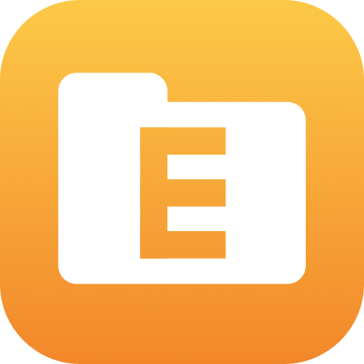

<p align="center">
  
</p>

<h1 align="center">CmdE</h1>

<p align="center"><strong>Press ⌘E anywhere on your Mac to open a new Finder window, like Win+E on Windows.</strong></p>

<p align="center">
  <a href="https://github.com/jackharvest/CmdE/releases/latest"></a>
  
  <a href="LICENSE"></a>
</p>

CmdE is a free, open-source macOS menu bar app that gives you the one Windows shortcut you can't stop reaching for: a global hotkey that always opens a **new Finder window**, from any app.

## The problem

On Windows, **Win+E** opens a new File Explorer window from anywhere. macOS has no equivalent. **⌘N** only works when Finder is already the frontmost app, and clicking Finder in the Dock just brings back an existing window, so the usual route is right-clicking the Dock icon and choosing **New Finder Window**. CmdE turns that into one keypress.

## Requirements

- macOS 13 (Ventura) or later

## Installing

### Option 1: Download the DMG (easiest)

1. Grab the latest `CmdE-x.y.z.dmg` from [Releases](https://github.com/jackharvest/CmdE/releases/latest).
2. Open it and drag **CmdE** onto the **Applications** shortcut.
3. Open CmdE from your Applications folder.

CmdE isn't notarized by Apple (no paid developer account behind this), so macOS will refuse to open it the first time. Click **Done**, go to **System Settings > Privacy & Security**, scroll down, and click **Open Anyway** next to the CmdE message. You only need to do this once.

The first time you press ⌘E, macOS will ask whether CmdE may control Finder. Click **Allow**. That's the only permission it needs.

### Option 2: Build from source

No Xcode required, just the Swift toolchain that ships with Command Line Tools:

```sh
git clone https://github.com/jackharvest/CmdE.git
cd CmdE
./build.sh
cp -R CmdE.app /Applications/
open /Applications/CmdE.app
```

## Usage

Press **⌘E**. A new Finder window opens at whatever **Finder > Settings > General > New Finder windows show** is set to, exactly like ⌘N.

Click the folder icon in the menu bar for everything else:

- **New Finder Window** - the same thing as pressing ⌘E.
- **Enabled** - claims or releases ⌘E instantly. Turn it off and ⌘E goes straight back to whichever app you're using.
- **Launch at Login** - on by default the first time you open CmdE from Applications, since a hotkey is only useful if it's always running. Uncheck it and it stays off.
- **Install Updates Automatically** - on by default. CmdE checks GitHub once a day and installs new versions quietly in the background, with no popups. Turn it off and a new version only appears as an **Update to x.y.z…** item in this menu.
- **Check for Updates…** - checks right now and asks before installing.
- **Uninstall CmdE…** - releases ⌘E, removes the login item, clears saved settings and the Finder permission, and moves CmdE.app to the Trash (recoverable until you empty it).
- **Quit CmdE** - exits without uninstalling.

## Uninstalling

Use the **Uninstall CmdE…** menu item above. If CmdE won't launch for some reason, you can undo everything by hand instead:

1. Open **System Settings > General > Login Items**, remove CmdE if it's listed.
2. Open **System Settings > Privacy & Security > Automation**, turn off Finder under CmdE if it's listed.
3. Delete `/Applications/CmdE.app`.
4. Optionally delete its saved settings: `defaults delete com.jackharvest.cmde`

## How it works

CmdE registers ⌘E with `RegisterEventHotKey`, the classic Carbon global hotkey API, which needs no Accessibility or Input Monitoring permission and can't see any other keystrokes. On each press it reads Finder's `NewWindowTarget` preference and sends Finder an Apple Event: `make new Finder window`, pointed at that location. It has to be Apple Events because simply opening a folder only brings forward a window already showing it, rather than making a new one.

## Releasing

`./release.sh` builds the app and packages it into a DMG (`CmdE-x.y.z.dmg`) with the custom background in `scripts/dmg_background.png` and a drag-to-Applications layout, via [dmgbuild](https://github.com/dmgbuild/dmgbuild) (`pip3 install --user dmgbuild`). It also creates `CmdE-x.y.z-app.zip`, which is what the in-app updater installs. Bump `CFBundleShortVersionString` in `Info.plist` first, then attach **both** files to a release tagged `vx.y.z`.

## FAQ

**Isn't there already a shortcut for this?**
Not a global one. ⌘N only works inside Finder. ⌥⌘Space opens a Finder *search* window, and the Dock menu needs the mouse.

**What happens to ⌘E in other apps?**
While CmdE is enabled, it owns ⌘E system-wide, so apps stop receiving it. That includes **Eject** in Finder (use the eject icon in the sidebar instead), **Use Selection for Find** in Safari, Chrome, Mail and TextEdit, and **Center** in Word. Untick **Enabled** whenever you need one of those back.

**Does CmdE need Accessibility permission?**
No. It only needs Automation permission for Finder, and it never sees your other keystrokes.

**Is CmdE safe to run? Does it send any data anywhere?**
CmdE's only network traffic is the update check: once a day it reads this repo's latest release from the GitHub API, and it downloads the new version from there when there is one. Nothing about you or your Mac is sent. Read `main.swift`; the entire app is a few hundred lines.

**I clicked Don't Allow on the Finder prompt.**
Press ⌘E again and CmdE will offer to open **System Settings > Privacy & Security > Automation**, where you can turn Finder on under CmdE.

**I use Dvorak or Colemak.**
The hotkey is tied to the physical key labeled E on a US QWERTY layout, so it may land on a different letter for you.

**Why not just use BetterTouchTool, Raycast, or a Shortcuts automation?**
Those can do this too, and much more, but they're large general-purpose tools. CmdE is a single-purpose, fully open-source implementation that does exactly one job.

## License

MIT, see [LICENSE](LICENSE).
